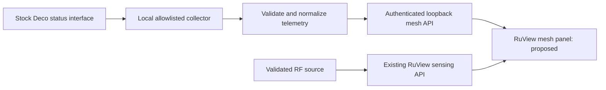

# 04 — Integration design (proposed)

## Desired state and effect

Expose truthful stock mesh telemetry beside RuView's RF sensing data, with
explicit freshness, provenance and capability negotiation. This design is
**CLAIMED/proposed** until a target response and contract are validated.

## Prerequisites

Complete playbook 01 and the selected-tool review in playbook 03 before choosing
a production access path. Unknown firmware or absent responses keep the design
provisional; the assessment playbook supplies any relevant exposure findings.

## Source-backed boundary

At RuView baseline `3a1bf6dae78d1b6a9b0f249c16dc65ceb17ebe76`:

- `v2/crates/wifi-densepose-sensing-server/src/main.rs` registers
  `GET /api/v1/status`, `GET /api/v1/sensing/latest`, `GET /api/v1/nodes`
  and `GET /ws/sensing`. These are existing output surfaces, not generic
  mesh-telemetry ingestion endpoints.
- The same file registers `POST /api/v1/rf/vendors/:vendor/events`.
  `src/vendor_rf.rs` selects registered providers; no Deco provider is present.
  Do not send a Deco payload under another vendor's name.
- Accepted ADR-270 requires capability separation and provider/wire contracts
  before vendor coupling. ADR-295 and `src/provenance.rs` distinguish
  synthetic, live_verified, live_unverified, stale and disconnected sources.
- `docs/integrations/home-assistant.md` describes RuView's MQTT output.
  That does not make arbitrary MQTT messages valid sensing inputs.

## Access-path decision

Prefer a verified local stock management status interface. Community source S2
is an interoperability reference, not a vendor API guarantee. Owner authentication
may create/refresh session state even though collection uses status reads.
Cloud-only access, undocumented binary extraction or exploit-dependent collection
does not satisfy the first local bridge gate. If no local path is verified,
record that outcome and pause the collector implementation at fixture mode.

### Observed stock UI declarations (E21/E22)

After the owner connected the Mac to the mesh, the verified main unit returned
HTTP 200 at `/` with a meta-refresh to `/webpages/index.html`. That index also
returned HTTP 200. Static files were read without executing downloaded code,
logging in, or querying protected status endpoints. `js/app/url.js` declares
the `/cgi-bin/luci/;stok=` session prefix.

| UI source under `/webpages/` | Declared route / observation | Validation still required |
|---|---|---|
| `modules/login/localLogin/models.js` | `/login?form=keys` and `/login?form=auth` read proxies; `/login?form=login` uses `operation=login` | Review the complete crypto/session flow and transport before credential use |
| `modules/networkMap/mapClients/models.js` | `/admin/client?form=client_list`; default `device_mac` parameter | Authenticated schema, complete node coverage and rate units |
| `modules/networkMap/mapRouter/models.js` | `/admin/device?form=device_list`, explicit `operation=read` | Model/revision/firmware coverage and per-node identity |
| Same router model source | `/admin/network?form=performance`; `cpu_usage` / `mem_usage` multiplied by 100 for UI percentages | Actual value range, availability and response error handling |

The client model declares `client_type`, `name`, `mac`, `ip`, `down_speed`,
`up_speed`, `connection_type` and `online`. These declarations support a
candidate parser design, not claims that all fields are returned or reliable.
During that static-only pass no authentication keys, credentials, session tokens
or protected responses were requested. Static file hashes in PR notes support
later comparison. Subsequent normal browser navigation in the owner's signed-in
session observed live UI values (E26–E29), without extracting credentials/session
material or making custom API requests.

The client UI labels rates KB/s, but this does not yet settle the raw API scale
or decimal/binary interpretation. Preserve a dash connection value as unknown.
The per-node selector's label changed during inspection; filtered row membership
was not witnessed after refresh, so association parsing remains an open test.
Signed-in status also exposed WAN/LAN fields and radio channel/enable state.
The firmware table supplies all eight model/revision/firmware tuples. These are
measured UI capabilities; they do not establish a standalone collector contract.

Strict HTTPS verification failed with an untrusted-chain error. A subsequent
public-certificate-only inspection timed out during the handshake and produced
no fingerprint. No trust was installed and no credentials were sent. Browser
inspection and verified certificate enrollment remain necessary for the future
collector transport. The owner's successful browser session and origin allowlist
change permit UI research; neither verifies the collector's TLS trust chain.

First implementation: a separate bridge namespace and RuView consumer, leaving
the sensing pipeline intact. Proposed bridge routes: `GET /health` and
`GET /v1/mesh/snapshot`, bound to loopback with a per-install credential. These
routes do not exist yet. A later native Deco provider requires an accepted
provider/wire ADR, exact source changes and tests under ADR-270.

## Proposed contract

| Field | Meaning and rule |
|---|---|
| `schema_version` | Integer version; reject unsupported versions |
| `source` / `evidence` | `deco_local` plus MEASURED or SYNTHETIC; never silently upgrade a fixture |
| `source_state` | ADR-295 vocabulary; authentication errors cannot become live_verified |
| `observed_at` / `received_at` | UTC source time if available / collector receipt time; do not invent a source clock |
| `sequence` | Collector session sequence; reset accompanied by a new session identifier |
| `capabilities` | Only fields observed on exact firmware; no CSI/pose/vitals flags |
| `nodes` | Stable local aliases, observed model/revision/firmware and uplink; missing values null |
| `clients` | Local pseudonymous IDs, optional association/band and rates with explicit units |
| `collection` | Last success, errors, duration and freshness policy; failure is not an empty mesh |

Use install-local keyed identifiers for device MACs; rotating private client
MACs can create new identities. Keep the mapping private. Do not export SSIDs,
addresses, hostnames or room labels by default. Preserve raw units internally;
convert only after measurement. Keep unsupported fields null rather than zero.

Default proposal: poll every 30 seconds, one collection in flight, a bounded
5-second request timeout and at most one transient retry within a cycle. Back
off 30/60/120/300 seconds with jitter on repeated transport failures; stop
credential retries on auth rejection. A complete successful empty client list
can mean no clients; an error or partial page cannot. Mark data stale after
90 seconds without a complete success; after restart show disconnected until
a new valid response. Document this as policy, not a hardware property.

Validate response size (initial budget 1 MiB), nesting/array bounds, finite
numbers, units, known enum values and timestamps. Preserve partial node
coverage. API client IP/host is an explicit owner-selected target, not a default
gateway guess. Reject redirects and prevent credential reuse across origins.

Store credentials in macOS Keychain. Prefer verified TLS; if the device uses
a self-signed certificate, explicitly enroll and pin its fingerprint after local
identity verification. Changed certificates fail closed. A legacy HTTP-only
interface needs a documented transport decision before any credentials are
sent; protocol payload encryption is not a substitute for authenticated TLS.
Never make global TLS verification disablement the default.

## Validation and completion

Require sanitized, permission-cleared real-response fixtures and separately
watermarked synthetic edge cases. Test malformed/oversize responses, missing
fields, auth expiry, certificate changes, rate-unit conversion, partial node
coverage, duplicate/out-of-order updates, stale transitions and secret redaction.
Prove that no configuration/reboot endpoint is reachable through the collector.
Pin the firmware/API adapter compatibility matrix. Gate passes with a reviewed
contract and exact-device evidence; a parser test alone proves no hardware claim.

## Recovery

Stop polling, retain the last snapshot as stale and show a useful error. Keep
the mesh panel usable when sensing is offline and vice versa. Roll back by
disabling/removing the bridge consumer; never change router configuration.
